

  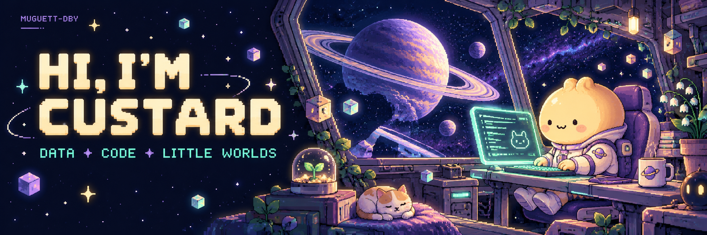

  <picture>
    <source media="(max-width: 600px) and (prefers-reduced-motion: reduce)" srcset="./assets/profile/typing-static-mobile.svg" />
    <source media="(prefers-reduced-motion: reduce)" srcset="./assets/profile/typing-static.svg" />
    <source media="(max-width: 600px)" srcset="./assets/profile/typing-mobile.svg" />
    
  </picture>

  
  
  
  

  <picture>
    <source media="(max-width: 600px)" srcset="./assets/profile/intro-mobile.svg" />
    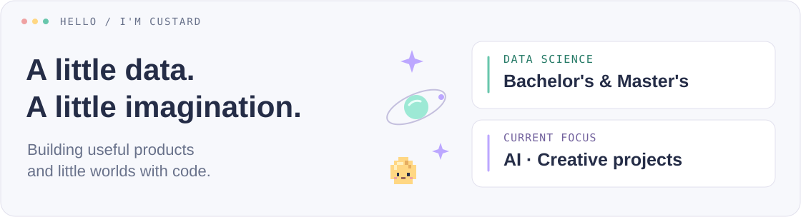
  </picture>

<strong>Data &amp; AI</strong> &nbsp;·&nbsp; Web products &nbsp;·&nbsp; Creative experiments

  
  
  
  
  
  
  
  
  

  
   
  Across all my public repositories · Updated daily

  <picture>
    <source media="(max-width: 600px)" srcset="./assets/profile/achievement-shelf-mobile.svg" />
    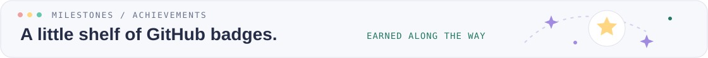
  </picture>

<!-- earned-achievements:start -->

  
  
  
  
  

<a href="https://github.com/Muguett-DBY?tab=achievements">Earned on GitHub</a> · Updated daily

<!-- earned-achievements:end -->

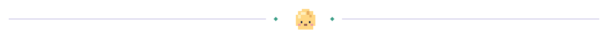

### Selected projects

  <picture>
    <source media="(max-width: 600px)" srcset="./assets/profile/projects-workshop-mobile.svg" />
    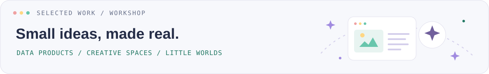
  </picture>

<table>
  <tr>
    <td width="40%" valign="middle">
      <a href="https://hireway.custard.top"><picture><source media="(prefers-reduced-motion: reduce)" srcset="./assets/projects/hireway-home.png" />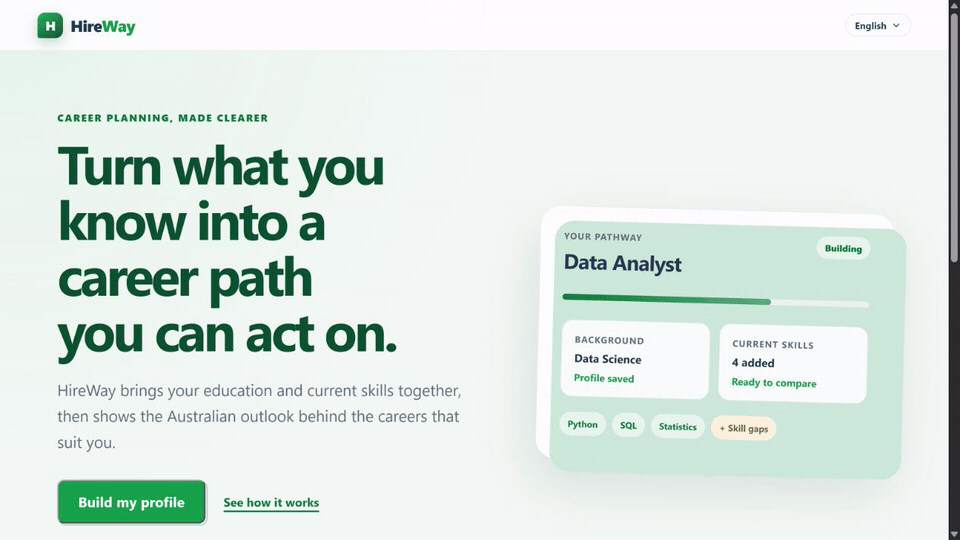</picture></a>
    </td>
    <td width="60%" valign="middle">
      <h4><a href="https://github.com/Muguett-DBY/HireWay">HireWay</a></h4>
      Australian career exploration, starting with your education and skills. 
      <a href="https://hireway.custard.top">Visit ↗</a> · <a href="https://github.com/Muguett-DBY/HireWay">Code</a>
    </td>
  </tr>
  <tr>
    <td width="40%" valign="middle">
      <a href="https://shoot.custard.top">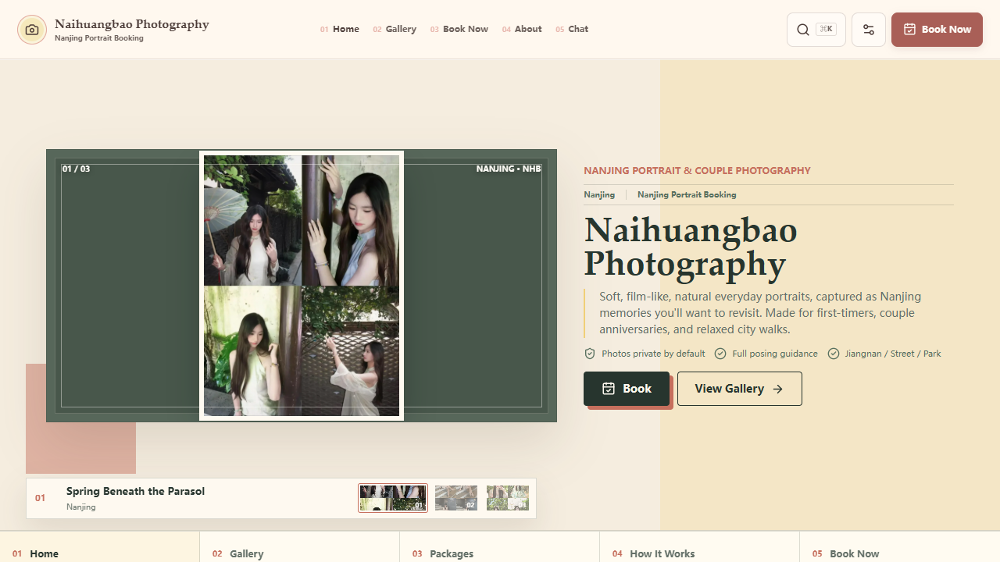</a>
    </td>
    <td width="60%" valign="middle">
      <h4><a href="https://github.com/Muguett-DBY/naihuangbao-photography">Naihuangbao Photography</a></h4>
      A visual home for portraits, galleries, and booking information. 
      <a href="https://shoot.custard.top">Gallery ↗</a> · <a href="https://github.com/Muguett-DBY/naihuangbao-photography">Code</a>
    </td>
  </tr>
  <tr>
    <td width="40%" valign="middle">
      <a href="https://custard.top/en">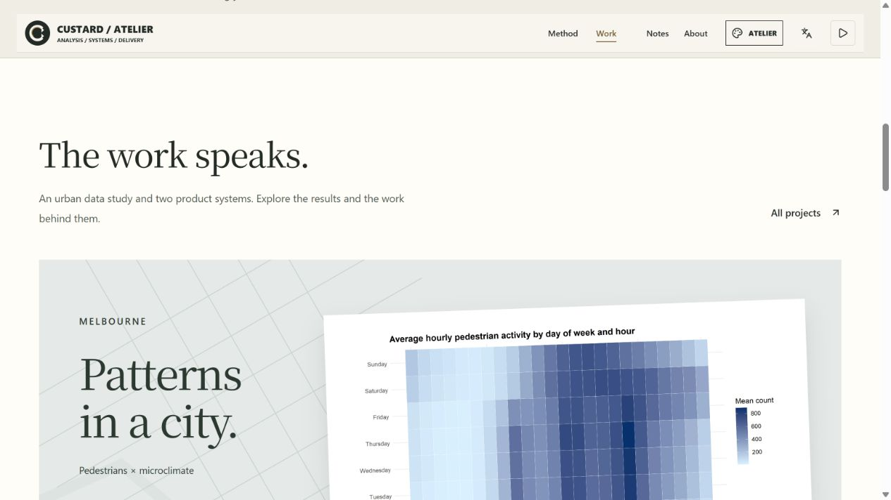</a>
    </td>
    <td width="60%" valign="middle">
      <h4><a href="https://github.com/Muguett-DBY/RocoDex">Custard Web</a></h4>
      My work, engineering notes, and experiments in one home. 
      <a href="https://custard.top/en">Visit ↗</a> · <a href="https://github.com/Muguett-DBY/RocoDex">Code</a>
    </td>
  </tr>
  <tr>
    <td width="40%" valign="middle">
      <a href="https://github.com/Muguett-DBY/veilreach-mod"></a>
    </td>
    <td width="60%" valign="middle">
      <h4><a href="https://github.com/Muguett-DBY/veilreach-mod">Veilreach</a></h4>
      A Minecraft dimension of silver fog, moonlit ruins, and star-altars. 
      <a href="https://github.com/Muguett-DBY/veilreach-mod">Explore ↗</a>
    </td>
  </tr>
</table>

Website screenshots and original concept artwork · <a href="./CREDITS.md#public-project-previews">Preview details</a>.

  
Earlier work: CalmJourney

An archived city-travel project about quieter spaces and crowd insights. The source is kept for reference; the backend is paused.

<a href="https://github.com/Muguett-DBY/CalmJourney">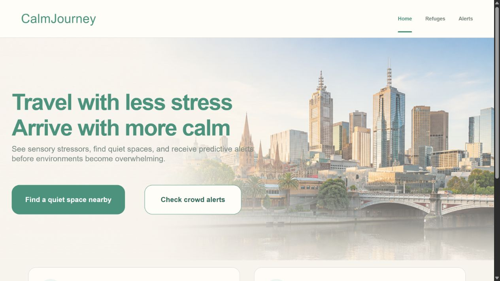</a>

[Explore the source archive ↗](https://github.com/Muguett-DBY/CalmJourney)

### A little city, built one commit at a time

  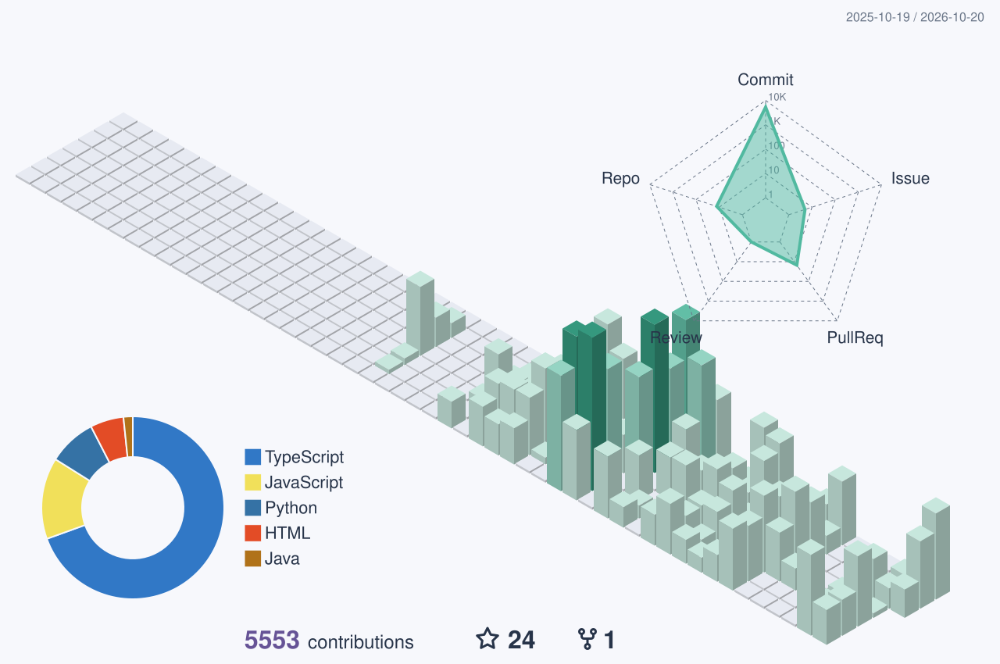

Public GitHub activity over the past year · Updated daily · Generated <!-- city-date -->2026-10-30<!-- /city-date -->. Colours adapt to light and dark themes.

  <picture>
    <source media="(prefers-color-scheme: light)" srcset="./assets/contribution-snake-light.svg" />
    
  </picture>

A little contribution arcade · Snapshot <!-- snake-date -->2026-10-31<!-- /snake-date -->

### Shipped upstream

  <picture>
    <source media="(max-width: 600px)" srcset="./assets/profile/upstream-logbook-mobile.svg" />
    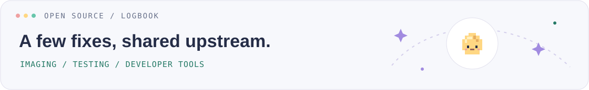
  </picture>

<table>
  <tr>
    <td width="72" valign="middle"></td>
    <td valign="middle"><strong><a href="https://github.com/pandas-dev/pandas-stubs">pandas-stubs</a></strong> 
      <a href="https://github.com/pandas-dev/pandas-stubs/pull/2048">Align Series window signatures with pandas 3</a></td>
  </tr>
  <tr>
    <td width="72" valign="middle"></td>
    <td valign="middle"><strong><a href="https://github.com/python-pillow/Pillow">Pillow</a></strong> 
      <a href="https://github.com/python-pillow/Pillow/pull/10328">Fix CMYK and keep_rgb MPO saving</a> · <a href="https://github.com/python-pillow/Pillow/pull/10300">Align CI check names</a> (co-authored)</td>
  </tr>
  <tr>
    <td width="72" valign="middle">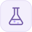</td>
    <td valign="middle"><strong><a href="https://github.com/MaciejZiel/pytest-queryguard">pytest-queryguard</a></strong> 
      <a href="https://github.com/MaciejZiel/pytest-queryguard/pull/210">Serve mounted ASGI panels</a> · <a href="https://github.com/MaciejZiel/pytest-queryguard/pull/211">Preserve WSGI file responses</a> · <a href="https://github.com/MaciejZiel/pytest-queryguard/pull/202">Keep query timings stable</a> · <a href="https://github.com/MaciejZiel/pytest-queryguard/pull/203">Attribute WSGI queries</a></td>
  </tr>
  <tr>
    <td width="72" valign="middle"></td>
    <td valign="middle"><strong><a href="https://github.com/nmloc/gh-achievements">gh-achievements</a></strong> 
      <a href="https://github.com/nmloc/gh-achievements/pull/6">Detect earned badges more reliably</a></td>
  </tr>
  <tr>
    <td width="72" valign="middle"></td>
    <td valign="middle"><strong><a href="https://github.com/zoltanf/extrudo">Extrudo</a></strong> 
      <a href="https://github.com/zoltanf/extrudo/pull/131">Check attachment limits before imports and copies</a></td>
  </tr>
</table>

  
More from my GitHub workshop: statistics

  
  

Cards generated on <!-- cards-date -->2026-10-31<!-- /cards-date -->. Total PRs are all-time; commits cover the last year. Language shares describe repository code, not skill levels.

### Keep exploring

[Personal website](https://custard.top) · [Engineering notes](https://custard.top/en/notes) · [All repositories](https://github.com/Muguett-DBY?tab=repositories)

Have an idea or found a bug? Open an issue in the project.

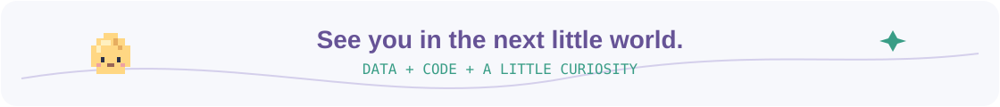

  
Made with a little help from open source

Technology icons by [Skill Icons](https://github.com/tandpfun/skill-icons). Contribution city by [GitHub Profile 3D Contrib](https://github.com/yoshi389111/github-profile-3d-contrib). Additional artwork uses [GitHub Stats Extended](https://github.com/stats-organization/github-stats-extended), [Snake](https://github.com/Platane/snk), [Readme Typing SVG](https://github.com/DenverCoder1/readme-typing-svg), and [Capsule Render](https://github.com/kyechan99/capsule-render). See [credits and license notices](./CREDITS.md).

Original code is available for noncommercial use under [PolyForm Noncommercial 1.0.0](LICENSE). See [license scope and third-party assets](docs/LICENSE_SCOPE.md).
