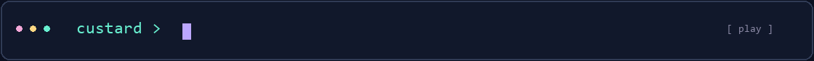
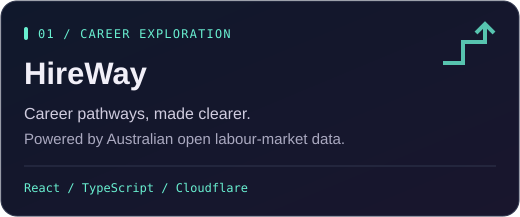
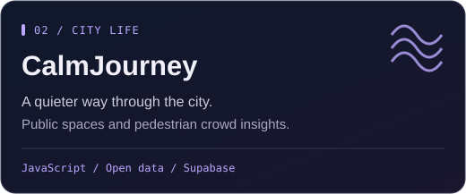
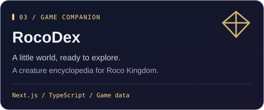
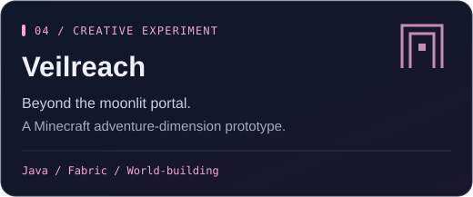

  

  <a href="#things-ive-been-building"><strong>Step into my workshop ↓</strong></a>
  &nbsp; · &nbsp;
  <a href="https://github.com/Muguett-DBY?tab=repositories">Explore my repositories</a>

  

### A little about me

I'm **Custard**, a builder working across **data science, web products, and interactive worlds**. My projects range from career exploration and quieter city journeys to creature encyclopedias and Minecraft experiments.

- 🎓 **Bachelor's & Master's:** Data Science
- 🧠 **PhD Year 0:** Artificial Intelligence
- 🛠️ **On my workbench:** useful interfaces, open-data projects, and research tools
- 🎮 **Creative side quests:** game tools, pixel worlds, and Minecraft mods

### My toolkit

  
  
  
  
  
  
  
  
  

### Things I've been building

<table>
  <tr>
    <td width="50%" valign="top">
      
      
<a href="https://github.com/Muguett-DBY/HireWay">Source code</a> &nbsp;·&nbsp; <a href="https://hireway.custard.top">Explore HireWay ↗</a>

    </td>
    <td width="50%" valign="top">
      
      
<a href="https://github.com/Muguett-DBY/CalmJourney">Source code</a> &nbsp;·&nbsp; <a href="https://calmjourney.custard.top">Explore CalmJourney ↗</a>

    </td>
  </tr>
  <tr>
    <td width="50%" valign="top">
      
      
<a href="https://github.com/Muguett-DBY/RocoDex">Source code</a> &nbsp;·&nbsp; <a href="https://rocodex.custard.top">Explore RocoDex ↗</a>

    </td>
    <td width="50%" valign="top">
      
      
<a href="https://github.com/Muguett-DBY/veilreach-mod">Explore the prototype ↗</a>

    </td>
  </tr>
</table>

### Explore further

Browse [all my repositories](https://github.com/Muguett-DBY?tab=repositories) for more experiments. For questions or suggestions about a specific project, its repository is the best place to start.

  

